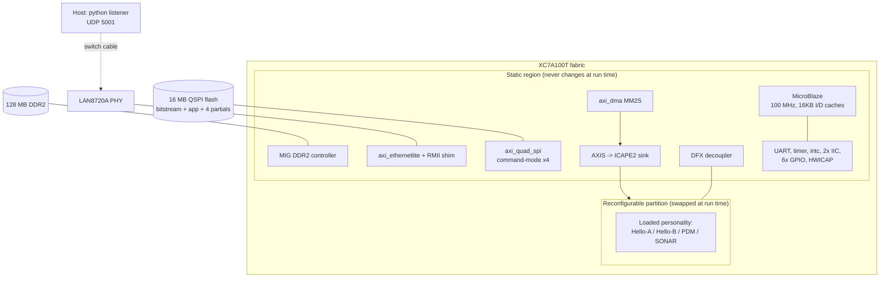
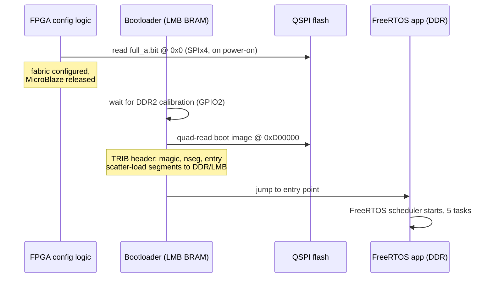

# Tricorder System Walkthrough

How the whole instrument works, end to end: the FPGA design, the
processor and RTOS on top of it, the communication paths (on-chip,
network, flash), and the mechanism that swaps sensor "personalities"
into the fabric at run time. Companion documents: `plan.md` (history and
milestones), `manual.md` (operating it), `telemetry-spec.md` (wire
format), `wiring.md` (harness), `demo.md` (demo script), `notebook.md`
(the experimental record behind every claim here).

Target: Digilent Nexys A7-100T (Artix-7 XC7A100T), Vivado/Vitis 2025.2.

## 1. The big picture



One bitstream contains everything static; a ~1 MB region of the fabric
(the reconfigurable partition, RP) is rewritten in ~1 ms while the rest
of the chip — CPU, DDR, Ethernet, the works — keeps running.

## 2. Hardware: the static region

The block design (`hw/bd/static_region.tcl`) is a classic MicroBlaze
SoC. Address map highlights (all AXI4-Lite unless noted):

| Address | Peripheral | Role |
|---|---|---|
| `0x00000000` | LMB BRAM | vectors + QSPI bootloader (baked into the bitstream) |
| `0x40000000`–`0x4005xxxx` | GPIO 0–5 | switches, LEDs, 7-seg, audio, DDR-calib status, decoupler |
| `0x40600000` | UART-lite | 115200 console |
| `0x40800000` | AXI IIC 0 | external JA sensor bus |
| `0x40810000` | AXI IIC 1 | on-board ADT7420 |
| `0x40E00000` | axi_ethernetlite | MAC (polled, no ping-pong) |
| `0x41C00000` | AXI timer | swap timing + FreeRTOS tick |
| `0x41E00000` | AXI DMA | MM2S stream that feeds the ICAP sink |
| `0x44A00000` | AXI HWICAP | present but **unused** (see §6.3) |
| `0x44A10000` | RM register window | the loaded personality's registers |
| `0x44A20000` | AXI Quad SPI | flash access (command mode) |
| `0x60000000` | QSPI XIP window | dead end, kept for reference (entry 24) |
| `0x80000000` | MIG DDR2 | 128 MB: code, data, staging buffers |

Details that took experiments to get right:

- **Caches are mandatory.** MicroBlaze with cache "None" has no
  instruction path to DDR at all — the PC freezes at `0x80000000`
  (entry 13). 16 KB I/D caches, MIG on the cached port.
- **Vectors stay in LMB.** The linker wants `.vectors` in DDR; the
  build (`sw/scripts/build_rtos.py`) patches the linker script per
  section so reset/interrupt vectors stay at 0 in BRAM.
- **Ethernet is a hand-written RMII shim** (`hw/rtl/rmii_shim.v`):
  Xilinx dropped `mii_to_rmii` from 2025.2. The PHY's 50 MHz REFCLK is
  forwarded through an ODDR **inverted** (D1=0/D2=1) — forwarding it
  in phase gives ~0 ns margin at the PHY sampling edge and TX then
  works or fails on placement luck (entries 32–33, re-proved by A/B in
  entry 35).
- **Quad SPI runs in command mode** (0x6B fast-read-quad-output, 8
  overhead bytes/burst). True XIP was tried three ways and the flash
  never answers the XIP core's framing (ILA-proven, entry 24). The QE
  bit lives in flash CR1 — non-volatile, but **Vivado's flash
  programmer clears it on every programming pass** (entry 35); the app
  restores it at boot.

## 3. Boot: from power-on to a running RTOS



Flash layout (16 MB S25FL128S, `hw/scripts/build_flash.tcl`):

| Offset | Content |
|---|---|
| `0x000000` | `full_a.bit` — static + Hello-A personality + bootloader in BRAM |
| `0x900000` | Hello-A partial (1 MB slot) |
| `0xA00000` | Hello-B partial |
| `0xB00000` | PDM partial |
| `0xC00000` | SONAR partial |
| `0xD00000` | boot image (app ELF segments, TRIB format) |

Two MCS images are required: the config bitstream needs standard bit
order, the data slots are written with `-disablebitswap` (entry 25 —
the ICAP path does its own bit reversal in wiring, §6.2). Slot offsets
and lengths are generated into `sw/tricorder-rtos/src/slots.h`, which
is **compiled into the app** — any change to partial sizes forces app
rebuild → boot image repack → re-flash, in that order (entry 36).

## 4. Software: FreeRTOS task structure

Classic MicroBlaze (no FreeRTOS port exists for MicroBlaze-V), Vitis
SDT flow. Five tasks; the shared blackboard is `ui_live` (`ui.h`) plus
the `sensors` struct (`sensors.h`) — every field has exactly one
writer, so plain `volatile` suffices, no locks:

| Task | Prio | Job |
|---|---|---|
| `beat` | +1 | heartbeat LED + periodic console tick |
| `sens` | +2 | `sensors_init()` then 1 Hz `sensors_poll()`: bounded I2C reads, one round-robin probe per pass |
| `dfx` | +3 | watches `ui_live.req_rm`; performs personality swaps (§6) |
| `ui` | +1 | 15 switches → exclusive functions, 7-seg readouts, sounds; publishes switch events |
| `net` | +1 | owns the MAC: polls RX, DHCP client, emits all frames (§5) |

The single-writer rule extends to the network: only `net_task` touches
the MAC. Other tasks publish records and bump a sequence number
(`evt_seq` for switch events, `dfx_seq` for swaps); `net_task` notices
and emits. No mutexes anywhere in the hot paths.

The sensor layer (`sensors.c`) drives both AXI IIC cores with a
bounded polled driver. Two PG090 traps cost a debugging session
(entry 34): the interrupt status register is **toggle-on-write** (a
blind "clear" write fabricates TX_ERROR), and TX_ERROR doubles as
"slave transmit complete" (the master's own end-of-read NAK raises it,
racing the final byte into the RX FIFO). Devices move through
UNKNOWN → PRESENT/ABSENT/ERROR with hysteresis; identity-only devices
(BME688 etc., ID-checked but no value driver yet) are parked in ERROR
so telemetry can never carry fabricated readings.

## 5. Communication

### 5.1 Console (UART, 115200)

Every subsystem logs: boot chain, sensor state transitions, DFX swaps,
network events. First stop for diagnosis.

### 5.2 Ethernet + telemetry

No lwIP — a raw-frame stack in `net.c` over the polled EmacLite:
ARP, ICMP echo, UDP, and a DHCP client. The PHY is brought up over
MDIO with a self-test (internal loopback, then **verify** BMCR bit 14
actually cleared — a PHY stuck in loopback looks exactly like a dead
cable, entry 33).

Three frame types, all UDP broadcast port 5001, plain-text `key=value`
lines (`telemetry-spec.md` is the authority):

1. **Telemetry** — 1 Hz, fixed 75 keys. Live sensors report values;
   everything else reports sentinels: `-1` absent, `-2` error, `-3`
   not-applicable (signed keys use `-1000001/-2/-3` because e.g.
   `temp_cc=-1` is a legal reading). Fabric keys are gated by the
   loaded personality's capability mask — a swap in progress reports
   N/A rather than reading through the decoupler.
2. **Switch events** (`type=event`) — aperiodic, on any switch change:
   switch number/name, state (`active`/`idle`/`error` for
   multi-switch), raw mask.
3. **DFX swap events** (`type=dfx`) — aperiodic, one per attempted
   swap: from/to personality id + name, both partial sizes in bytes,
   `swap_us`, signature verdict (`ok`/`mismatch`), lifetime counter.

Host side: `nc -ulp` shows one datagram then exits; use a small python
listener loop (see `manual.md`).

## 6. DFX: how personalities change at run time

The heart of the instrument. A "personality" is a partial bitstream
implementing one sensor pipeline in the reconfigurable partition:
Hello-A, Hello-B (counters/pattern generators), PDM (microphone
capture: PCM samples, energy, SPL), SONAR (burst TX + echo capture).

### 6.1 Floorplan and boundary

The RP is an explicit pblock (`SLICE_X52Y100:X89Y149` +
`DSP48_X1Y40:X2Y59` — CLOCKREGION-based ranges with SNAPPING silently
snapped to empty, entry 15). `RESET_AFTER_RECONFIG` is set, so the
region comes up cleanly after each swap. The static↔RM interface is a
fixed port list (boundary v3): AXI-Lite register window at
`0x44A10000` (count, signature, control, aux), clocks, and the
decoupler in between. Build order matters: black-box the RM, **then**
`lock_design` (the reverse fails), then implement each RM
configuration against the locked static; `pr_verify` across all four
routed checkpoints is a hard gate in `hw/dfx/build_dfx.tcl`.

### 6.2 The load path

```mermaid
sequenceDiagram
    participant UI as ui_task
    participant DFX as dfx_task
    participant SPI as Quad SPI
    participant DDR as DDR2 bounce buffer
    participant DMA as AXI DMA (MM2S)
    participant SINK as AXIS->ICAPE2 sink (fabric)
    participant RP as Reconfig partition
    participant NET as net_task
    UI->>DFX: switch SW0-SW3 -> ui_live.req_rm
    DFX->>SPI: quad-read partial from flash slot
    SPI->>DDR: ~300-410 KB into bounce buffer
    DFX->>RP: DECOUPLE = 1 (isolate boundary)
    DFX->>DMA: SA = buffer, LEN = partial size
    DMA->>SINK: AXI4-Stream burst @ wire speed
    SINK->>RP: ICAPE2 writes (byteswap + bitrev in wiring)
    DFX->>RP: DECOUPLE = 0
    DFX->>RP: read signature register
    alt signature matches
        DFX->>DFX: cur_rm = new, swaps++, swap_us recorded
    else mismatch
        DFX->>UI: alert sound; cur_rm stays -1
    end
    DFX->>NET: dfx_seq++ -> type=dfx frame on the wire
```

Numbers on hardware: the ICAP stream itself is **~1.0–1.1 ms** for a
300–410 KB compressed partial (`swap_us` in every dfx frame). The
flash→DDR staging read is the slow part (~6 s, CPU-bound quad reads);
it happens *before* the decoupler engages, so the instrument stays
live during it. Partials are built with bitstream compression, which
roughly halved them (entry 22).

### 6.3 Why raw ICAPE2 and not the HWICAP IP

AXI HWICAP v3.0's write FSM wedges on this class of design (CR stuck,
write FIFO drained, DALIGN never asserts — entry 14); tying `eos_in`
high is necessary but not sufficient. The replacement is a ~50-line
AXIS-to-ICAPE2 sink on the second ICAP site, fed by AXI DMA. Two
encoding quirks make it work:

- Partials must come from `write_bitstream -bin_file` — `write_cfgmem`
  output never syncs the ICAP (entry 16).
- ICAPE2 wants each 32-bit word byte-swapped **and** each byte
  bit-reversed vs the .bin file. `byteswap ∘ bitrev8` = full 32-bit
  reversal, which is free in fabric wiring — the sink's data pins are
  simply connected in reverse order.

### 6.4 Trust: the signature check

Every personality exposes a 32-bit signature register (Hello-A
`0xA5A5A5A5`, Hello-B `0x5B5B5B5B`, PDM `0x9D3A0001`, SONAR
`0x50A40001`). After each swap the CPU reads it back; a mismatch
plays the alert sound, marks the swap failed (`sig=mismatch` in the
dfx frame), leaves `cur_rm = -1`, and — if the source was flash —
falls back to DDR staging for subsequent swaps. The check has caught
real bugs: a post-increment slot-index error in the C driver loaded
the *wrong slot's* valid bitstream, and only the signature noticed
(entry 26).

### 6.5 Personalities and the switch UI

SW0–SW3 request PDM / SONAR / Hello-B / Hello-A respectively
(exclusive, like all 15 switch functions; multiple switches = `Err
SEL` + alert). The capability mask per personality gates which
telemetry keys go live: PDM enables `pcm/energy/mic_*`, SONAR enables
`sonar_*/adc_*/dac_*/afe_*`, the Hello pair enables nothing. RM-internal
counters (e.g. `peak`) are capability-gated only, so they stay live
without any external harness declared.

## 7. Build and verify quick reference

```bash
# hardware (only when RTL/BD/XDC change): static + 4 RM configs + pr_verify
vivado -mode batch -source hw/dfx/build_dfx.tcl

# software
vitis -s sw/scripts/build_rtos.py

# flash images + program (then restore QE: run the app once via JTAG)
vivado -mode batch -source hw/scripts/build_flash.tcl
vivado -mode batch -source hw/scripts/program_flash.tcl

# JTAG dev loop (no flash)
xsdb hw/scripts/run_elf.xsdb build/dfx/full_a.bit \
     build/vitis-ws/tricorder_rtos/build/tricorder_rtos.elf

# watch it
python3 - <<'EOF'
import socket
s = socket.socket(socket.AF_INET, socket.SOCK_DGRAM)
s.bind(("", 5001))
while True: print(s.recvfrom(2048)[0].decode(), end="")
EOF
```

Gates that must hold: `pr_verify` PASS, 75 lines per telemetry frame,
`tele_overflow` = 0 in soak, signature `ok` on every swap, and the
listener showing live values for wired sensors and sentinels — never
fabrications — for everything else.
