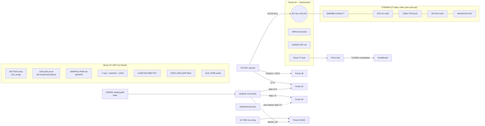
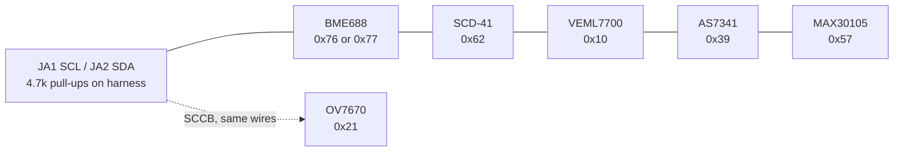

# Tricorder Sensor Wiring — Nexys A7-100T

Wiring for the full sensor complement of `docs/plan.md` §2, pin-exact
against `hw/constraints/tricorder-nexys-a7-100t.xdc` (LOCs verified
against the current Digilent master XDC). All header logic is 3.3 V.
Connector hardware is the shopping list in `docs/plan.md` §6 /
`docs/tricorder_parts.xlsx`.

Pmod pin numbering used throughout (2×6 socket, top row 1–6, bottom row
7–12): pins **5, 11 = GND**, pins **6, 12 = VCC 3V3**; the eight signal
pins are 1–4 and 7–10.

## 1. System overview



Header budget: **40/40 signal pins used, zero spares.** Reserves exist
only on dedicated nets (BTND, CPU_RESETN, sw[4:15], led[4:15], VGA,
microSD, PS/2).

## 2. Pmod JA — I2C bus + slow control

| Pin | FPGA | Signal | Wire to |
|-----|------|--------|---------|
| JA1 | C17 | `i2c_scl` | STEMMA QT chain SCL (yellow) + OV7670 SIOC |
| JA2 | D18 | `i2c_sda` | STEMMA QT chain SDA (blue) + OV7670 SIOD |
| JA3 | E18 | `sipm_pulse` | SiPM eval comparator output (async in, 4× oversampled) |
| JA4 | G17 | `sipm_thresh_pwm` | SiPM threshold RC filter input |
| JA5/11 | — | GND | harness ground |
| JA6/12 | — | VCC 3V3 | I2C chain V+ (see power notes) |
| JA7 | D17 | `afe_gain_pwm` | AD8332 GAIN (via RC filter) |
| JA8 | E17 | `afe_hilo` | AD8332 HILO |
| JA9 | F18 | `sonar_tx_a` | piezo drive A (via driver) |
| JA10 | G18 | `sonar_tx_b` | piezo drive B (complementary; also the documented swap target if mic ch5 shows crosstalk) |

### I2C daisy chain (single bus, six devices)



- Breakouts daisy-chain with JST-SH (STEMMA QT / Qwiic) cables; entry to
  the harness via one JST-SH-to-male-dupont adapter into JA1/JA2.
- Breakouts carry their own pull-ups — no discrete resistors on the
  harness beyond the 4.7 k pair at the connector.
- OV7670's SCCB rides the same two wires (address 0x21); its RST/PWDN
  are strapped on the module.
- No address conflicts: 0x10, 0x21, 0x39, 0x57, 0x62, 0x76/0x77.

## 3. Pmods JB + JC — OV7670 camera

| Pin | FPGA | Signal | OV7670 pin |
|-----|------|--------|------------|
| JB1 | D14 | `cam_xclk` | XCLK (FPGA-generated 24 MHz) |
| JB2 | F16 | `cam_href` | HREF |
| JB3 | G16 | `cam_vsync` | VSYNC |
| JB4 | H14 | `cam_data[0]` | D0 |
| JB7 | E16 | `cam_data[1]` | D1 |
| JB8 | F13 | `cam_data[2]` | D2 |
| JB9 | G13 | `cam_data[3]` | D3 |
| JB10 | H16 | `cam_pclk` | PCLK — **the only P-side clock-capable (MRCC) header pin on the board; do not move** |
| JC1 | K1 | `cam_data[4]` | D4 |
| JC2 | F6 | `cam_data[5]` | D5 |
| JC3 | J2 | `cam_data[6]` | D6 |
| JC4 | G6 | `cam_data[7]` | D7 |

Keep `cam_pclk` on a 10 cm run. SCCB goes to JA1/JA2, not JB/JC.

## 4. Pmods JC + JD — AD9226 ADC / AD9708 DAC shared bus

The DAC time-shares the ADC's low byte through static-region IOBUFs:
ADC personality reads 12 bits, DAC personality drives bits 7:0.

| Pin | FPGA | Signal | | Pin | FPGA | Signal |
|-----|------|--------|-|-----|------|--------|
| JD1 | H4 | `adcdac_data[0]` | | JD9 | G2 | `adcdac_data[6]` |
| JD2 | H1 | `adcdac_data[1]` | | JD10 | F3 | `adcdac_data[7]` |
| JD3 | G1 | `adcdac_data[2]` | | JC7 | E7 | `adcdac_data[8]` |
| JD4 | G3 | `adcdac_data[3]` | | JC8 | J3 | `adcdac_data[9]` |
| JD7 | H2 | `adcdac_data[4]` | | JC9 | J4 | `adcdac_data[10]` |
| JD8 | G4 | `adcdac_data[5]` | | JC10 | E6 | `adcdac_data[11]` |

Clock: `adcdac_clk` on **JXADC XA_N4 (A18)** — FPGA sources it,
system-synchronous capture.

**Derating:** ≤ 40 MS/s behind the Pmod 200 Ω series resistors — 65 MS/s
is unsupported on this board. Short (10 cm) harness mandatory. The AD8332
AFE's analog output feeds the AD9226 input over SMA (RG316 male-male +
SMA-to-0.1" pigtails).

## 5. Pmod JXADC — PDM microphone array

Digital use (100 Ω series resistors are fine for PDM rates).

| Pin | FPGA | Signal | Wire to |
|-----|------|--------|---------|
| XA_P1 (JXADC1) | A13 | `pdm_clk` | all mic CLK inputs, fanned out on breadboard |
| XA_N1 (JXADC7) | A14 | `pdm_data[0]` | mic 0 DATA |
| XA_P2 (JXADC2) | A15 | `pdm_data[1]` | mic 1 DATA |
| XA_N2 (JXADC8) | A16 | `pdm_data[2]` | mic 2 DATA |
| XA_P3 (JXADC3) | B16 | `pdm_data[3]` | mic 3 DATA |
| XA_N3 (JXADC9) | B17 | `pdm_data[4]` | mic 4 DATA |
| XA_P4 (JXADC4) | B18 | `pdm_data[5]` | mic 5 DATA — **pair-coupled with `adcdac_clk`; watch for crosstalk during ADC runs, documented swap is `sonar_tx_b`/JA10** |
| XA_N4 (JXADC10) | A18 | `adcdac_clk` | AD9226/AD9708 clock |

The on-board ADMP421 is the 7th mic on dedicated nets J5/H5/F5 — no
harness wiring.

## 6. Sonar / piezo chain

```
sonar_tx_a (JA9) ──┐
                   ├─ driver ── piezo disc (2-pin screw terminal, twisted pair)
sonar_tx_b (JA10) ─┘                │
                                    └─ AD8332 AFE (SMA) ── AD9226 ADC (JC/JD bus)
   receive path alternative: TLV3501 comparator on breadboard → sipm_pulse-style GPIO
afe_gain_pwm (JA7) ── RC ── AD8332 GAIN
afe_hilo     (JA8) ───────── AD8332 HILO
```

## 7. On-board sensors (no harness wiring)

| Sensor | Interface | Pins | Telemetry keys |
|--------|-----------|------|----------------|
| ADT7420 temp | I2C bus 1 @ 0x4B | C14/C15 (+irq) | `temp_cc` |
| ADXL362 accel | SPI | E15/F14/F15/D15 (+irq) | `acc_*` (sentinels until an SPI core is added — deviation D1) |
| ADMP421 PDM mic | PDM | J5/H5/F5 | `pcm`, `energy`, `mic_*` |
| XADC | internal DRP | — | `xadc_*` (sentinels — MIG owns the primitive, deviation D1) |
| LAN8720A PHY | RMII | dedicated | telemetry transport |
| S25FL128S flash | QSPI | dedicated | personalities + boot |

## 8. Power

- Everything runs from Pmod 3V3.
- **SCD-41 has ~200 mA peaks — give it its own Pmod VCC pin (JA6 *or*
  JA12, alone); do not stack it with the camera.**
- Piezo drive and SiPM bias stay off the Pmod rail (screw terminal /
  eval-board supply respectively).
